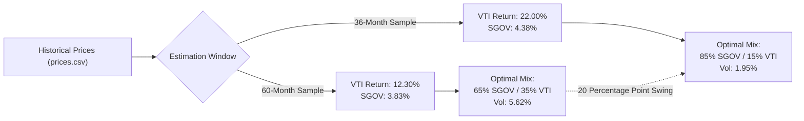

# Project 2 — Investment Management Application
## Meridian Foundation Portfolio Allocation & Decision System

> **AI Disclosure:** This application, models, and documentation were developed with assistance from Google Antigravity (featuring Anthropic Claude and Google Gemini models) for code architecture, testing, refactoring, and documentation drafting. In accordance with course policy, all data audits, code verifications, mathematical implementations, and final investment recommendations are the sole work and responsibility of the author.  
> **Course Disclaimer:** Built for FIN 43900 (AI in Finance) at Purdue University. This repository is a learning demonstration and research model, **not investment advice**.

---

## 1. Quickstart — Cold-Run Reproduction

A stranger can clone this repository and run the primary investment management application with a single command.

### Prerequisites & Setup
Clone the repository, ensure Python 3.10+ is installed, create an environment, and install dependencies:

```bash
# Clone the canonical Project 2 repository
git clone https://github.com/aalderin/FIN439_project2.git
cd FIN439_project2

# Create and activate virtual environment
python -m venv .venv

# Windows PowerShell:
.\.venv\Scripts\Activate.ps1
# macOS / Linux:
source .venv/bin/activate

# Install required packages
pip install streamlit pandas
```

### The Primary Run Commands

| Interface / Component | Command | What it demonstrates |
| :--- | :--- | :--- |
| **Primary App (Portfolio Explorer)** | `streamlit run app.py` | Interactive portfolio optimizer, mandate constraint validator, and estimation window stress test. |
| **Point-in-Time Explorer** | `streamlit run asof_app.py` | ALFRED vintage release inspector demonstrating point-in-time data hygiene for `T10Y2Y`. |
| **Legend Investor Panel App** | `streamlit run Skill/buffett_app.py` | SEC EDGAR 10-K parser running multi-investor deterministic checks (Buffett, Wood, Burry) on ticker data. |
| **CLI Optimization Engine** | `python portfolio.py` | Standard-library covariance matrix build, baseline comparisons, and grid-search optimizer. |
| **CLI Mandate Compliance** | `python mandate.py` | Meridian Foundation IPS policy check for candidate portfolios (Candidates A–D). |

---

## 2. Executive Summary & Investment Committee Recommendation

* **Recommendation:** **Pilot with tight bounds**, not full adoption.
* **Recommended Starting Allocation:** **65% SGOV** (iShares 0–3 Month Treasury), **35% VTI** (Vanguard Total Stock Market ETF).
  * Expected Return: **6.79%** (exceeds 6.5% mandate hurdle).
  * Volatility: **5.62%** (lowest-risk feasible mix).
  * Reserve-Eligible Weight: **65.0%** (exceeds 3.0% minimum requirement).
* **Allocation Range:** SGOV: 60%–85% | VTI: 15%–40% | VGIT: 0%–10% | VCIT: 0%–10%.
* **Why Pilot instead of Adopt:**
  * **Extreme Window Sensitivity:** Shortening the historical return estimation window from 60 months to 36 months induces a massive **20 percentage point shift** (SGOV surges from 65% to 85%, and VTI drops from 35% to 15%). The optimizer aggressively exploits the recent high annualized equity return (22.00% vs. 12.30% 5-year mean) to minimize equity weight while barely clearing the 6.5% hurdle.
  * **Input Instability:** Reducing VTI's expected return assumption by just 100 bps (from 12.3% to 11.3%) shifts 5 percentage points from cash into equities (60% SGOV / 40% VTI) to satisfy the return hurdle.
* **Ongoing Monitoring & Reversal Triggers:**
  1. *Stop / Kill Trigger:* If VTI forward expected return drops below 11.0% or 12-month rolling realized volatility exceeds 18%, pause automated rebalancing and freeze the pilot.
  2. *Yield Curve Shift:* Monitor ALFRED vintage `T10Y2Y`. A re-inversion below -0.20% triggers a defensive reserve check.
  3. *Review Horizon:* Quarterly audit with a 12-month pilot limit before considering institutional mandate capital.

---

## 3. Mandate & Portfolio Universe Specifications

### Mandate Parameters (Lab 13 / Lab 15)
* **Objective:** Identify the lowest-volatility long-only allocation that achieves an annualized expected return of at least **6.5%**.
* **Hard Reserve Constraint:** At least **3.0%** of the portfolio must be held in reserve-eligible liquid assets to cover scheduled quarterly foundation distributions ($0.75M/quarter on a $100M reserve pool).
* **Single-Issuer Limit:** No non-exempt single corporate issuer may exceed **8.0%** of total assets.

### Asset Universe
The investment universe comprises four liquid ETF sleeves representing the primary asset classes:

| Ticker | Fund Name | Role | Reserve-Eligible? |
| :--- | :--- | :--- | :---: |
| **SGOV** | iShares 0–3 Month Treasury Bond ETF | Cash proxy & short-term reserve | **Yes** |
| **VGIT** | Vanguard Intermediate-Term Treasury ETF | Government fixed income | **Yes** |
| **VCIT** | Vanguard Intermediate-Term Corporate Bond ETF | Investment-grade credit | No |
| **VTI** | Vanguard Total Stock Market ETF | Core broad equity | No |

### Pricing Data & Provenance
* File: [`prices.csv`](prices.csv)
* Source: Yahoo Finance Historical Adjusted Close (monthly frequency, dividend- and split-adjusted).
* History: 60 monthly observations spanning November 2021 through October 2026.
* Download Date: 2026-10-22.

---

## 4. Baselines and Mandate Verdicts

The application compares the optimized portfolio against two transparent baselines:

| Portfolio | SGOV | VGIT | VCIT | VTI | Expected Return | Volatility | Reserve Weight | Mandate Verdict |
| :--- | :---: | :---: | :---: | :---: | :---: | :---: | :---: | :--- |
| **Equal-Weight Baseline** | 25.0% | 25.0% | 25.0% | 25.0% | 4.36% | 5.37% | 50.0% | **FAIL** (Return < 6.5%) |
| **60/40 Equity/Bond Mix** | 0.0% | 20.0% | 20.0% | 60.0% | 7.64% | 10.36% | 20.0% | **PASS** (Return $\ge$ 6.5%, Reserve $\ge$ 3%) |
| **Optimized Mix (All Months)** | **65.0%** | **0.0%** | **0.0%** | **35.0%** | **6.79%** | **5.62%** | **65.0%** | **PASS** (Optimal lowest volatility) |

*The Equal-Weight baseline fails the return objective. While a traditional 60/40 mix passes, our constrained optimizer cuts volatility nearly in half (from 10.36% to 5.62%) by concentrating the defensive sleeve into high-yielding short cash (SGOV).*

---

## 5. Estimation Window Sensitivity & Stress Testing

The application conducts stress tests across estimation windows, input shocks, and constraints:

| Estimation Window | SGOV | VGIT | VCIT | VTI | Expected Return | Volatility | Reserve Weight |
| :--- | :---: | :---: | :---: | :---: | :---: | :---: | :---: |
| **Full Sample (60 Months)** | 65.0% | 0.0% | 0.0% | 35.0% | 6.79% | 5.62% | 65.0% |
| **Last 36 Months** | 85.0% | 0.0% | 0.0% | 15.0% | 7.02% | 1.95% | 85.0% |
| **Maximum Absolute Shift** | **+20.0 pts** | 0.0 pts | 0.0 pts | **-20.0 pts** | +0.23 pts | -3.67 pts | +20.0 pts |



### Locked Changed-Input Record
* **Input Changed:** VCIT expected return altered from 1.19% to 3.60% (tested in Lab 15 partner audit).
* **Pre-Run Prediction (AI-off):** Allocation will not change; 3.60% return is still below the 6.5% objective hurdle, and VCIT volatility (7.88%) exceeds SGOV (0.46%), meaning VCIT remains uncompetitive for a minimum-variance portfolio.
* **Observed Result:** Allocation remained exactly **65% SGOV / 35% VTI**. Prediction confirmed.

---

## 6. Point-in-Time Signal & Data Card (ALFRED / FRED)

To ensure the decision system operates without look-ahead bias or revision contamination, macroeconomic signals are audited under strict point-in-time rules.

* **Series ID:** `T10Y2Y` ([FRED Series Page](https://fred.stlouisfed.org/series/T10Y2Y))
* **Description:** 10-Year Treasury Constant Maturity Minus 2-Year Treasury Constant Maturity.
* **Frequency & Lag:** Daily release, published post-market (~4:03 PM CDT).
* **Provenance Gate Rule:** Never trade on today's observation at market open. Decisions must rely solely on ALFRED vintages released *prior* to market open on the decision date.
* **App Implementation:** `asof_app.py` enforces vintage isolation, tracking whether historical values underwent post-hoc revisions.

---

## 7. Multi-Lens Investor Panel (Skill Architecture)

The system incorporates an automated 10-K audit panel (`Skill/buffett_app.py`) evaluating securities through three distinct analytical lenses. Calculations are strictly deterministic code—never LLM estimates:

| Investor Lens | Deterministic Rules Evaluated | Focus / Philosophy |
| :--- | :--- | :--- |
| **Warren Buffett** | 1. ROE $\ge$ 15% in every fiscal year.<br>2. Owner Earnings > 0 in every year.<br>3. Owner Earnings (Year 5) > Owner Earnings (Year 1). | Business durability, capital efficiency, owner earnings compounding. |
| **Cathie Wood** | 1. 5-Year Revenue Growth > 0.<br>2. 5-Year Net Income Growth > 0.<br>3. 5-Year Owner Earnings Growth > 0. | Multi-year historical growth as a proxy for platform expansion. |
| **Michael Burry** | 1. Operating Cash Flow $\ge$ Net Income in every year.<br>2. Latest Balance Sheet: Liabilities $\le$ 2 $\times$ Equity. | Forensic accounting, cash conversion quality, debt resilience. |

*Missing Data Rule:* If any required XBRL tag is absent, the metric prints `not found` and the dependent check evaluates strictly to `not known`. It is never guessed or imputed.

---

## 8. Repository Structure & Artifact Manifest

```
FIN439_project2/
│
├── README.md                            # Project 2 master reproduction guide & documentation
├── app.py                               # Primary Streamlit portfolio management app
├── portfolio.py                         # Portfolio mathematics, covariance, & optimization engine
├── prices.csv                           # 60 monthly adjusted-close prices for SGOV, VGIT, VCIT, VTI
│
├── mandate.py                           # Meridian Foundation IPS compliance checker
├── meridian_mandate_classification.md   # Policy memo & classification report
│
├── asof.py                              # Point-in-time FRED/ALFRED data retrieval
├── asof_app.py                          # Streamlit point-in-time vintage explorer
│
├── lab-15-portfolio-stability.md        # Stability decision memo & stress-test report
├── lab-16-provenance-gate.md            # Data provenance & quarantine documentation
├── lab-17-point-in-time.md              # Point-in-time data card for T10Y2Y
├── lab-18-legend-investor-as-skill.md   # Buffett 10-K skill development & COST validation
├── lab-19.md                            # Three-investor panel report & NVDA evaluation
│
├── Skill/                               # Investor skill bundle
│   ├── SKILL.md                         # Skill system instructions and boundaries
│   ├── buffett_app.py                   # Multi-investor panel Streamlit application
│   ├── buffett_facts.py                 # SEC EDGAR XBRL facts parser
│   ├── investor_panel.py                # Deterministic check logic (Buffett, Wood, Burry)
│   ├── cost_buffett_memo.md             # Benchmark COST evaluation memo
│   ├── burry-10k-investor/              # Burry skill specification
│   ├── cathie-wood-10k-investor/        # Cathie Wood skill specification
│   └── graham-10k-investor/             # Benjamin Graham skill specification
│
└── Project 1/                           # Project 1 archive (excluded from Project 2 scope)
```

---

## 9. Presentation Video Directory

The Project 2 committee defense is supported by three video recordings (YouTube links with closed captions/transcripts):

* **Video 1 — System Evolution & AI Verification (< 3:00):** https://youtu.be/wVfqxKq1ilQ  
  *How the portfolio mandate, code, and constraints evolved from Lab 13 through Lab 19, including an audit of one AI-generated calculation ($\sqrt{12}$ volatility check).*
* **Video 2 — Technical Architecture & Cold Run (< 5:00):** https://youtu.be/oDl3nCiQbGY?si=mxMT9xOE6xYDQ5TP  
  *Step-by-step walkthrough of `portfolio.py` and `app.py`, executing the optimizer, comparing baselines, and validating the 5-point grid search.*
* **Video 3 — Investment Committee Defense (< 5:00):** https://youtu.be/2gz2A_SKcdE?si=RlbNzAVssLoAuZoJ  
  *Presentation of the **Pilot** recommendation, starting with the live Streamlit app, detailing the 20-point window sensitivity, and defining explicit stop-loss/kill triggers.*

