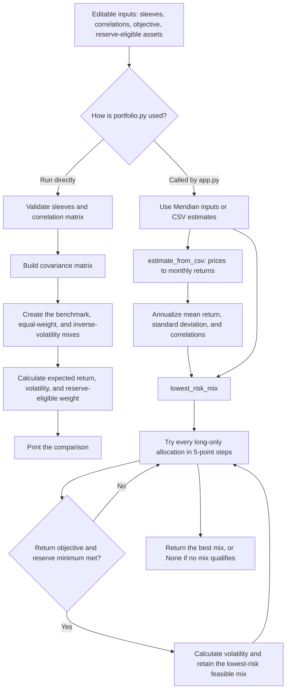

# Lab 15 — Portfolio Stability Decision

## Project 2 universe and mandate

| Ticker | Fund name | Role | Reserve-eligible? |
|---|---|---|---|
| SGOV | iShares 0–3 Month Treasury Bond ETF | Cash and reserve | Yes |
| VGIT | Vanguard Intermediate-Term Treasury ETF | Government bonds | Yes |
| VCIT | Vanguard Intermediate-Term Corporate Bond ETF | Investment-grade fixed income | No |
| VTI | Vanguard Total Stock Market ETF | Broad equity | No |

**Objective:** Find the lowest-volatility long-only portfolio with an estimated annual return of at least **6.5%**.

**Hard constraint:** At least **3.0%** of the portfolio must be in reserve-eligible assets (SGOV and VGIT).

## Prices, source, and download date

The input file is [`prices.csv`](prices.csv): 60 monthly adjusted-close observations, oldest first, from November 2021 through October 2026. Adjusted Close is used so the price series reflects distributions.

| Ticker | Source | Download date |
|---|---|---|
| SGOV | [Yahoo Finance Historical Data](https://finance.yahoo.com/quote/SGOV/history/?frequency=1mo) | 2026-10-22 |
| VGIT | [Yahoo Finance Historical Data](https://finance.yahoo.com/quote/VGIT/history/?frequency=1mo) | 2026-10-22 |
| VCIT | [Yahoo Finance Historical Data](https://finance.yahoo.com/quote/VCIT/history/?frequency=1mo) | 2026-10-22 |
| VTI | [Yahoo Finance Historical Data](https://finance.yahoo.com/quote/VTI/history/?frequency=1mo) | 2026-10-22 |

## `portfolio.py` flowchart

## Estimated inputs

These are historical **estimates**, not forecasts. `portfolio.py` calculates monthly returns from adjusted closes, then annualizes the monthly mean by multiplying by 12 and the sample standard deviation by multiplying by √12.

| Ticker | All-month estimated return | All-month volatility | Last-36-month estimated return | Last-36-month volatility |
|---|---:|---:|---:|---:|
| SGOV | 3.83% | 0.46% | 4.38% | 0.22% |
| VGIT | 0.12% | 5.51% | 4.40% | 4.67% |
| VCIT | 1.19% | 7.88% | 6.98% | 6.13% |
| VTI | 12.30% | 15.83% | 22.00% | 12.63% |

## Lowest-risk result under my mandate

| Estimation window | SGOV | VGIT | VCIT | VTI | Estimated return | Volatility | Reserve-eligible weight |
|---|---:|---:|---:|---:|---:|---:|---:|
| All monthly returns | 65% | 0% | 0% | 35% | 6.79% | 5.62% | 65.00% |
| Last 36 monthly returns | 85% | 0% | 0% | 15% | 7.02% | 1.95% | 85.00% |

The largest allocation change between the two estimation windows is **20 percentage points**: SGOV rises from 65% to 85%, while VTI falls from 35% to 15%. The calculation uses long-only allocations in 5-point steps, a 6.5% estimated-return objective, and a 3% reserve minimum.

## Meridian training check

| Run | Treasury bills | 10-year note | IG bond fund | Global equity fund | Return | Volatility |
|---|---:|---:|---:|---:|---:|---:|
| Meridian inputs as loaded | 0% | 20% | 25% | 55% | 6.51% | 9.44% |
| Equity estimate changed from 8.0% to 7.0% | 0% | 10% | 10% | 80% | 6.53% | 12.94% |

The largest Meridian weight change is **25 percentage points**. A one-point reduction in the equity estimate materially changes the selected allocation.

## Partner attack

My partner changed VCIT's expected-return estimate to **3.6%**, but the lowest-risk mix remained 65% SGOV and 35% VTI. This shows that, at that estimate, VCIT still does not improve on the feasible mix's volatility while meeting the 6.5% return objective.

## My call

**Starting allocation decision:** Pilot, not adopt: the app keeps the 65% SGOV / 35% VTI mix when reserve eligibility changes, but that is not a meaningful return-estimate stress test. If VTI's estimated return falls one point, the mix changes to 60% SGOV / 40% VTI, so I would adopt only after I am comfortable that the VTI return estimate is defensible.

## Reflection

1. **Why the lowest-risk mix moved so far:** The last-36-month sample gives VTI a much higher annualized return estimate (22.00%) than the full five-year sample (12.30%). Because the portfolio needs only enough VTI to clear the 6.5% objective, the optimizer can reduce VTI from 35% to 15% and place the remaining money in low-volatility SGOV; this shifts 20 percentage points into SGOV.

2. **What I would need before adopting it:** I would need evidence that the high recent VTI return estimate is a reasonable forward-looking assumption rather than a short-sample artifact. I would compare several historical windows and market scenarios, set a defensible long-run expected-return assumption, and confirm that the resulting allocation still supports the mandate's return and reserve requirements.
