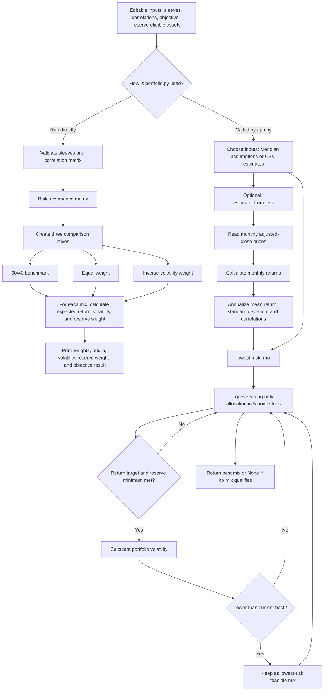

## `portfolio.py` flowchart

# Meridian Foundation: S1–S10 Mandate Classification

| # | Statement | Category | One-Line Reason |
|---|---|---|---|
| **S1** | Horizon seven years; annual rebalancing. | **Hard constraint** | Sets a fixed operational time horizon and a mandatory rebalancing schedule that binds portfolio management. |
| **S2** | Objective: CPI + 4% a year, net of costs, over rolling five-year periods. | **Objective** | Specifies the quantitative long-term real return hurdle required to preserve purchasing power and sustain the foundation's mission. |
| **S3** | Pays out $0.75 million every quarter; twelve months of payouts held in cash or daily-liquid government securities. | **Hard constraint** | Imposes a non-negotiable liquidity reserve requirement ($3.0M annual payout buffer) restricted to designated reserve-eligible assets. |
| **S4** | Benchmark: 60% global equities, 40% U.S. investment-grade bonds. | **Preference** | Serves as the strategic policy reference portfolio and relative asset allocation guide, rather than a strict allocation lock. |
| **S5** | Long-only: no borrowing, short sales or derivatives. | **Hard constraint** | Strictly prohibits leverage, short selling, and synthetic financial instruments. |
| **S6** | No single issuer above 8%. | **Hard constraint** | Establishes an absolute concentration cap aggregating all debt and equity securities from any single corporate issuer. |
| **S7** | Annual turnover at most 25% without committee approval. | **Hard constraint** | Places a firm ceiling on trading volume, making turnover above 25% impermissible without prior committee consent. |
| **S8** | At least 90% redeemable within five business days. | **Hard constraint** | Mandates a minimum structural liquidity threshold, capping illiquid assets (>5 business days to redeem) at 10%. |
| **S9** | "The reserve cannot have a calendar-year loss greater than 10%." No measure, no breach rule. | **Unverifiable promise** | Expresses an unmodeled downside aspiration without a statistical confidence level (e.g., VaR), distribution, or operational breach protocol. |
| **S10** | No sector, ESG, tax or home-bias preference; nobody has said what the pilot should optimize. | **Missing** | Leaves the mathematical objective function completely undefined, so the optimizer lacks a target to solve for. |

---

## Fund universe and monthly price sources

| Ticker | Fund name | Meridian role | Source | Download date |
|---|---|---|---|---|
| BIL | SPDR Bloomberg 1-3 Month T-Bill ETF | Cash and reserve | [Yahoo Finance monthly historical data](https://finance.yahoo.com/quote/BIL/history/?frequency=1mo&period1=1634754137&period2=1792520518) | 2026-10-20 |
| IEF | iShares 7-10 Year Treasury Bond ETF | Government bonds | [Yahoo Finance monthly historical data](https://finance.yahoo.com/quote/IEF/history/?period1=1634754281&period2=1792520669&frequency=1mo) | 2026-10-20 |
| LQD | iShares iBoxx $ Investment Grade Corporate Bond ETF | Investment-grade fixed income | [Yahoo Finance monthly historical data](https://finance.yahoo.com/quote/LQD/history/?period1=1634754323&period2=1792520719&frequency=1mo) | 2026-10-20 |
| VT | Vanguard Total World Stock ETF | Broad global equity | [Yahoo Finance monthly historical data](https://finance.yahoo.com/quote/VT/history/?period1=1634754351&period2=1792520748&frequency=1mo) | 2026-10-20 |

`prices.csv` contains monthly Yahoo Finance Adjusted Close values. Dates are calendar-month keys, ordered from oldest to newest.

---

## Candidate D & The Objection Analysis

### Summary of Candidate D
* **Allocation:** 3.0% Cash, 97.0% Global Equity Index Fund (all other assets 0.0%).
* **Compliance:** Passes every checkable rule in `mandate.py` (weights sum to 100%, long-only, 3.0% reserve-eligible $\ge 3.0\%$, 100% redeemable in $\le 5$ days $\ge 90.0\%$, 0% single-company issuer $\le 8.0\%$).

### Does the Objection Hold, and Which Statement Decides It?
* **The objection does NOT hold.**
* **Deciding Statement — S9 (governed by S3):**  
  * S9 restricts only **"the reserve"**, not the entire portfolio.
  * S3 defines the reserve as 12 months of quarterly distributions ($4 \times \$0.75\text{M} = \$3.0\text{M}$, or exactly 3.0% of the \$100M fund).
  * Candidate D holds that 3.0% reserve entirely in **Cash** (0% nominal loss), completely satisfying S9.
* **Deciding Statement — S10:**  
  * An objection based on benchmark divergence (97% equity vs. S4's 60/40 benchmark) fails because **S10** explicitly notes that *"nobody has said what the pilot should optimize"* and establishes no tracking-error limits or asset-class bands.

---

## The One Question the CIO Must Answer Before Anyone Optimizes

### The Question
> **"What is the mathematical objective function for the optimization (e.g., maximize expected return, maximize Sharpe ratio, or minimize tracking error to the 60/40 benchmark), and what is the maximum allowable active risk / allocation band around that benchmark?"**

### The Answer That Would Change Your Portfolio
* **The Answer:**  
  *"The objective is to minimize tracking error relative to the S4 benchmark (60% global equities / 40% U.S. investment-grade bonds), with a maximum tracking error of 1.5% (or strict asset-class bands of $60\% \pm 5\%$ equity and $40\% \pm 5\%$ fixed income)."*
* **How It Changes the Portfolio:**  
  * **Candidate D (97% equity / 3% cash) is immediately rejected** because its +37% equity active tilt incurs massive, impermissible tracking error.
  * The portfolio selection shifts back to **Candidate A** (60% global equity, 40% bonds/cash), which conforms directly to the 60/40 benchmark policy.

---

## Synthesis & Fiduciary Judgment

### 1. Why a Portfolio Can Pass Every Checkable Rule and Still Be Wrong for This Client
* **Feasibility vs. Suitability:** Automated code checks test only **negative feasibility guardrails** (e.g., weights sum to 100%, long-only, minimum liquidity buffers, issuer concentration caps). Passing these hurdles proves a portfolio is technically permissible, but not that it is economically appropriate.
* **Missing Risk & Objective Dimensions:** A mandate engine cannot check unquantified, unmodeled dimensions. As shown by Candidate D (97% global equities, 3% cash), an extreme corner portfolio satisfies all five literal mathematical constraints but:
  1. Takes an extreme +37% unhedged active equity bet that abandons the foundation's strategic 60/40 benchmark (S4).
  2. Exposes the endowment to 30%–50% equity drawdowns during bear markets, threatening intergenerational equity and long-term payout stability.
* **The "Letter vs. Spirit" Gap:** Without an explicit optimization target (S10) and an active risk / tracking-error budget, a portfolio can strictly obey the letter of every written rule while completely violating the fiduciary spirit of the client's mission.

### 2. The S1–S10 Statement Type Least Sure Of
* **Statement:** **S4** (*"Benchmark: 60% global equities, 40% U.S. investment-grade bonds."*)
* **Classification Tension:** **`Preference` vs. `Hard Constraint` vs. `Objective`**
  * *Why It Was Ambiguous:* In standard CFA IPS terminology, a strategic benchmark can function as an **Objective** (a relative return/risk hurdle against which performance is evaluated, Section 3b) or as a **Hard Constraint** (a target asset allocation from which unauthorized deviations are prohibited). 
  * *Why `Preference` Was Chosen:* Because the CIO provided no explicit tracking-error ceiling (e.g., $\text{TE} \le 2\%$) and no tolerance bands (e.g., $60\% \pm 5\%$), S4 cannot function as a mathematically testable hard constraint. It operates as an institutional policy *preference*—a desired strategic baseline—yet treating it merely as a preference creates the loophole that allows Candidate D's 97% equity distortion to pass code validation.
